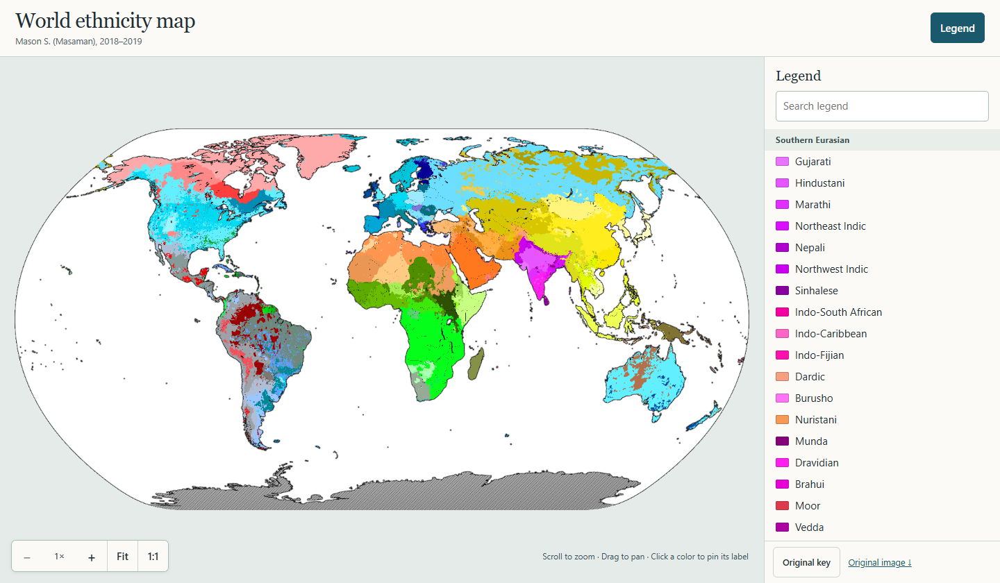
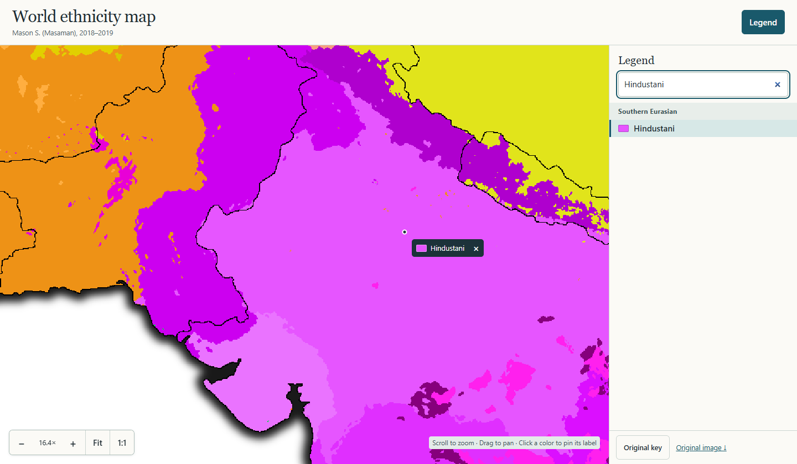

# Masaman Chart Viewer

Explore Mason S.'s 2018–2019 world ethnicity map at its original resolution. The same viewer and export command work with other color-keyed charts.





## Open the viewer

Start the local preview from the repository root:

```powershell
py main.py preview
```

Open [the local preview](http://127.0.0.1:4173/). It closes after two hours. In a foreground terminal, press Ctrl+C to stop it sooner. Run the command again to reopen it.

Scroll or pinch to zoom and drag to pan. **Fit** resets the view. **1:1** shows the chart at its source pixel size in CSS pixels. Hover for a label or click or tap to pin it. The **Legend** button opens the searchable key, with the original key and full image available at the bottom. Focus the image to use arrow keys, plus or minus, Enter to pin at the center, and Home to fit. Escape clears pins outside the search field and original key dialog.

## Export an offline copy

```powershell
py main.py export charts/masaman.json 'Masaman World Ethnicity Map.html'
```

Open the resulting HTML file directly in a browser. The chart, legend, original image, and viewer code are all in that one file. Choose a fresh output filename when exporting again.

## Add another chart

Put the image and a JSON definition together. Use a lossless image such as PNG when you want to identify exact colors. Paths are relative to the definition.

```json
{
  "title": "Sample chart",
  "credit": "Source credit",
  "image": "sample.png",
  "key": "sample-key.png",
  "original": "sample-original.png",
  "legend": [
    {
      "name": "Example group",
      "entries": [
        {"label": "Example label", "color": "#3c5a71", "aliases": ["#3c5a72"]}
      ]
    }
  ]
}
```

Only `title` and `image` are required. Use `key` for a crop of the printed key, `original` for the untouched source download, and `aliases` for known alternate pixel colors. Put the definition in `charts/` and preview it with `/?chart=charts/sample.json`, or pass it to the export command. Each chart needs its own source crops and checked color-to-label mapping.

Hover and pin lookup samples the source pixel under the pointer. It returns a label only for an exact swatch or explicit alias. Unlisted and ambiguous colors have no match. The map's labels reflect its author's classification.

## Rebuild the Masaman image assets

The source is `old-map.png`. The earlier palette-filtered PNG and experimental conversions are retained as historical inputs. The active viewer uses `charts/masaman-map.png` and `charts/masaman-key.png`. The map retains its ocean, coastlines, boundaries, and original colors. The crop removes the outer black matte and places the original key and attribution within reach of the viewer. All 184 swatches across eight groups were sampled from the original key and transcribed into `charts/masaman.json`.

Use Pillow and the sibling Photo Tools CLI with its `remove-background` command. From the repository root, using a fresh output for the intermediate:

```powershell
py -m pip install Pillow
$masked = 'C:/Users/marin/agent-files/trash/masaman-masked.png'
& '../tools-photo/bin/pt.cmd' remove-background old-map.png --color '#000000' --crop 26 29 11801 6176 -o $masked
py main.py prepare $masked
```

Preparation refreshes the two generated PNGs in `charts/`. It clears the small credit fragment beyond the map's lower-right edge and extracts the untouched key. The original source file includes the original credit block.

For verification, compare the output map's retained pixels with the matching crop of the source. Use the local preview and an offline export to check hover labels, pins, drag, zoom, and the original key. Check the legend and pinch gesture in a touch viewport.
