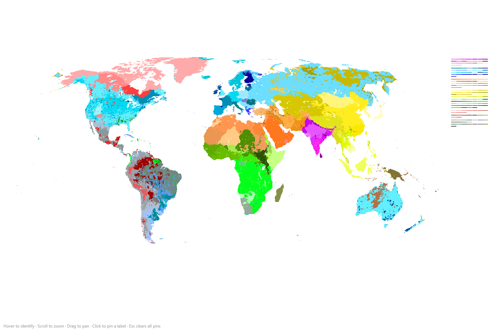
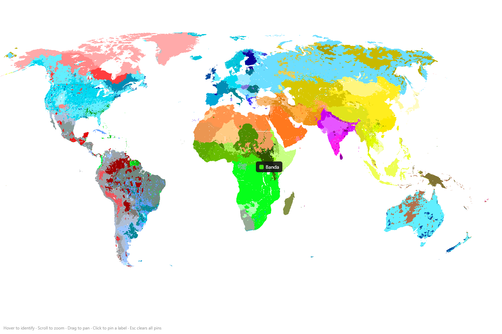
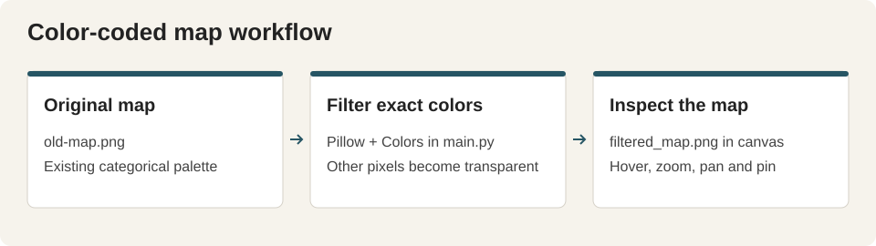

# Masaman Map Viewer

A canvas viewer for an existing color-coded ethnicity map. Hover over a colored region to see its mapped label, scroll to zoom, drag to pan and click to pin labels. Escape clears pins.







## Open the viewer

Open `index.html` in a browser. It reads the local `filtered_map.png` image. A loopback static server is also available with Python:

```powershell
py -m http.server 4173 --bind 127.0.0.1
```

Then visit `http://127.0.0.1:4173/`. Stop the server with Ctrl-C.

## Rebuild the filtered image

The Python helper requires Pillow:

```powershell
py -m pip install Pillow
py main.py
```

Run it from this directory. `main.py` reads `old-map.png`, keeps pixels whose exact RGB values are listed in its `Colors` mapping and makes every other pixel transparent. It writes `filtered_map.png`, replacing the existing generated image. The viewer's `colorNames` mapping in `index.html` determines which label appears for each color; keep the two mappings aligned when changing the palette.

| Path | Purpose |
| --- | --- |
| `old-map.png` | Original raster map supplied with the project |
| `filtered_map.png` | Palette-filtered raster used by the viewer |
| `main.py` | Exact-color image filtering |
| `index.html` | Canvas drawing, color lookup, zoom, pan and pinned labels |
| `graveyard/` | Preserved earlier material |

Labels describe the supplied map's classification. The viewer has no independent demographic dataset, date-aware boundaries or validation of those categories.
